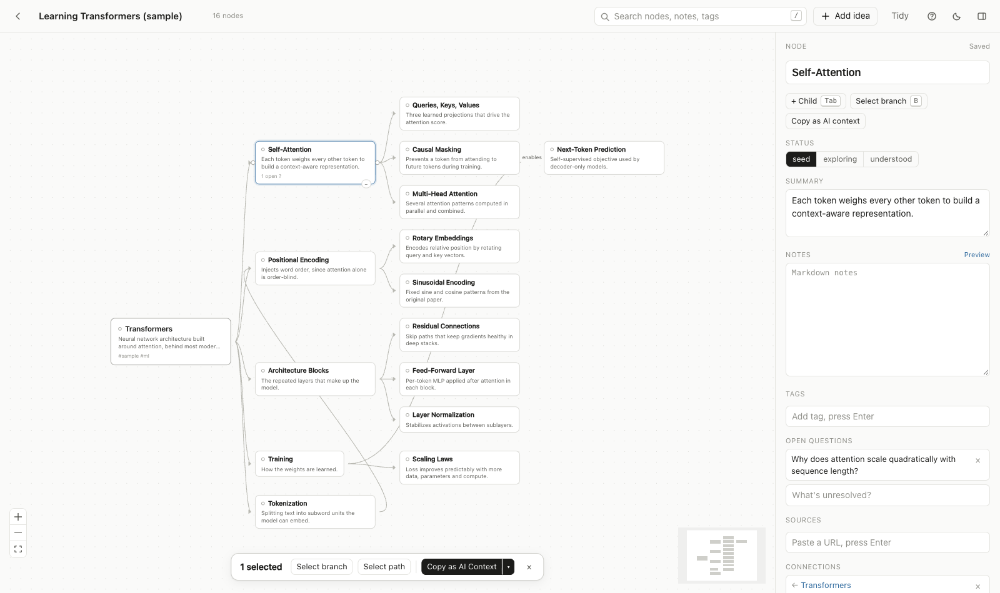
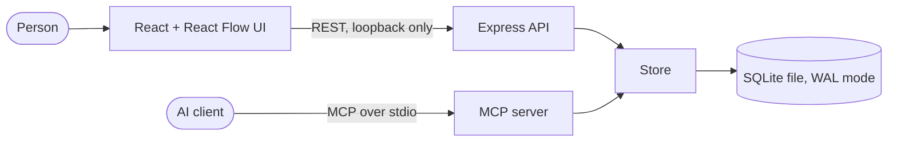

# Living Mindmap

A local-first visual knowledge graph that people edit by hand and AI agents extend through 12 MCP tools, with duplicate protection and provenance on every AI-added node.

[](#quick-start)

The screenshot shows the bundled sample map, "Learning Transformers (sample)". All data in this repository is sample data. There is no hosted demo. The app runs locally, so see [Quick start](#quick-start).

## In 30 seconds

- **Problem:** Ideas from long AI conversations vanish into chat history.
- **Build:** One SQLite store shared by a React Flow UI, a REST API, and a stdio MCP server with near-duplicate detection.
- **Result:** 42 tests, 0 failures across 160 real MCP calls, 0.5 ms median per call.

Everything is stored in one SQLite file. There are no accounts and no cloud services.

## Quick start

Requires Node 20 or newer.

```bash
git clone <this repository> mindmap-mcp
cd mindmap-mcp
npm install
npm start
```

Open http://127.0.0.1:4317 and click **Load demo maps** (or run `npm run seed`) to load the sample map. Data lives in `./data/mindmap.db` and can be moved with the `MINDMAP_DB` environment variable. For hot reload during development, run `npm run dev`.

To confirm the MCP server starts and lists its tools with a real client, run `npm run verify:mcp`.

## Connect an AI client

Replace `/ABSOLUTE/PATH/TO/mindmap-mcp` with the folder where you cloned the project.

Claude Code:

```bash
claude mcp add living-mindmap -e MINDMAP_DB=/ABSOLUTE/PATH/TO/mindmap-mcp/data/mindmap.db -- npx tsx /ABSOLUTE/PATH/TO/mindmap-mcp/src/mcp/index.ts
```

Claude Desktop (`claude_desktop_config.json`):

```json
{
  "mcpServers": {
    "living-mindmap": {
      "command": "npx",
      "args": ["tsx", "/ABSOLUTE/PATH/TO/mindmap-mcp/src/mcp/index.ts"],
      "env": { "MINDMAP_DB": "/ABSOLUTE/PATH/TO/mindmap-mcp/data/mindmap.db" }
    }
  }
}
```

Then try this prompt: "Add our discussion about episodic versus semantic agent memory to my Living Mindmap."

## MCP tools

| Tool | Purpose |
| --- | --- |
| `list_maps` | Find the right map |
| `get_map` | Compact nodes and edges of a map |
| `search_nodes` | Full-text search in one map or all maps |
| `get_node` | One node in full with parents, children and sources |
| `create_node` | Add a concept, optionally linked to a parent with a relationship label |
| `update_node` | Replace fields, or enrich with `append_notes`, `add_tags` and `add_questions` |
| `delete_node` | Requires `confirm: true`, otherwise returns a preview |
| `create_edge` | Connect two nodes (idempotent) |
| `delete_edge` | Remove one connection |
| `get_branch` | A node with its descendants, or its ancestors |
| `add_source` | Attach a URL as evidence, without duplicates |
| `get_ai_context` | Markdown or JSON context for a root, branch or list of ids |

Two behaviors are worth knowing. First, `create_node` rejects near-duplicate titles and returns the candidates, and `allow_duplicate: true` overrides the check. Second, every node written through MCP carries `provenance: ai`, and the UI shows a small AI marker. Errors are structured as `{ error, code, details }` and never crash the server.

## Architecture



The web server and the MCP server are separate processes that open the same SQLite file. The UI polls every few seconds, so edits made by an agent appear in an open browser tab.

```
src/core/     schema, migrations, Store (all reads and writes), search, duplicate detection, AI context builder
src/shared/   pure graph helpers (branches, collapse, tidy layout)
src/server/   Express REST API (loopback only) and static UI hosting
src/mcp/      MCP server (stdio) on top of the same Store
src/web/      React and React Flow UI
tests/        vitest suites for store, graph, context, REST API and MCP tools
scripts/      MCP verification, benchmark, screenshot and browser end-to-end scripts
```

## Using the web UI

| Do this | Get this |
| --- | --- |
| Double-click the canvas or press `N` | New idea at that spot |
| `Tab` on a node | Add a child |
| `Enter` on a node | Add a sibling |
| `R` | Add a related idea |
| `B` | Select a branch |
| Copy as AI Context | Markdown for the selected nodes |
| `/` or `Cmd+K` | Search all maps |

## Measured results

The benchmark in `scripts/bench.ts` starts the real stdio server and runs a scripted 16-call task ten times (list, create ten nodes, then read the map back five ways). On Node 26, the last run completed 160 calls with 0 failures and a median round trip of about 0.5 ms (95th percentile about 1.2 ms). Run it yourself with `npm run bench`. Numbers vary by machine.

## Tests

`npm test` runs 42 vitest tests across 6 files, and all of them pass. The suites cover the store, graph layout, context export, the REST API, the seed data and the MCP tool handlers through an in-memory MCP client. `npm run typecheck` and `npm run lint` are clean, and GitHub Actions runs install, typecheck, lint, build, test and the MCP verification on Node 20 and 22. The browser acceptance flow in `npm run e2e` needs Google Chrome.

## Built by

Built by Garfield Greg Lim III. [Portfolio](https://monsieurgregorio2001-coder.github.io/)

## License

MIT, copyright 2026 Garfield Greg Lim III.
